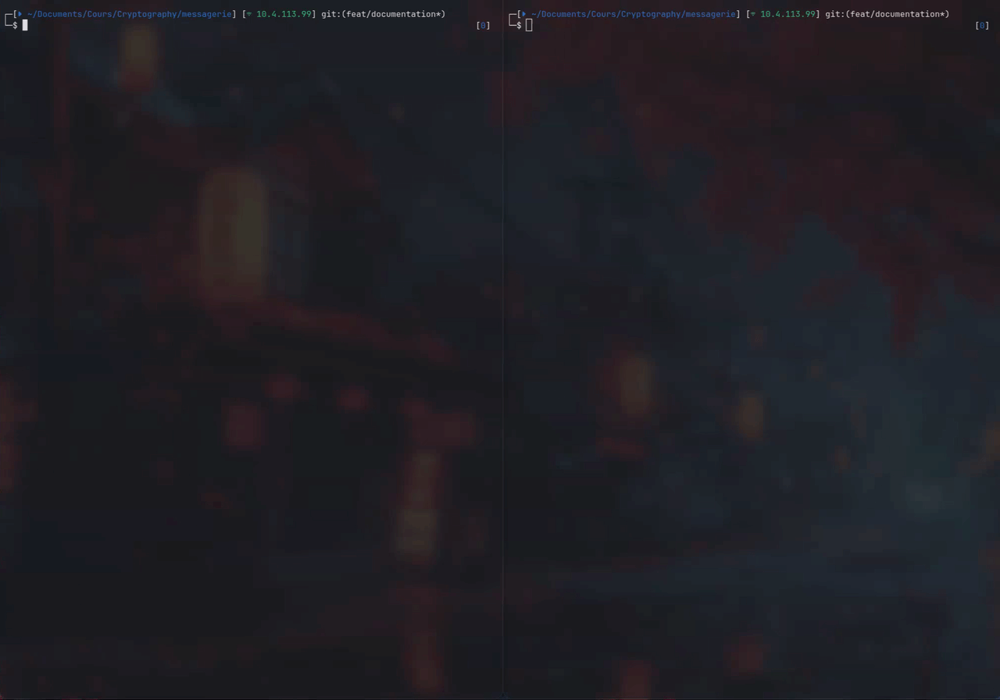
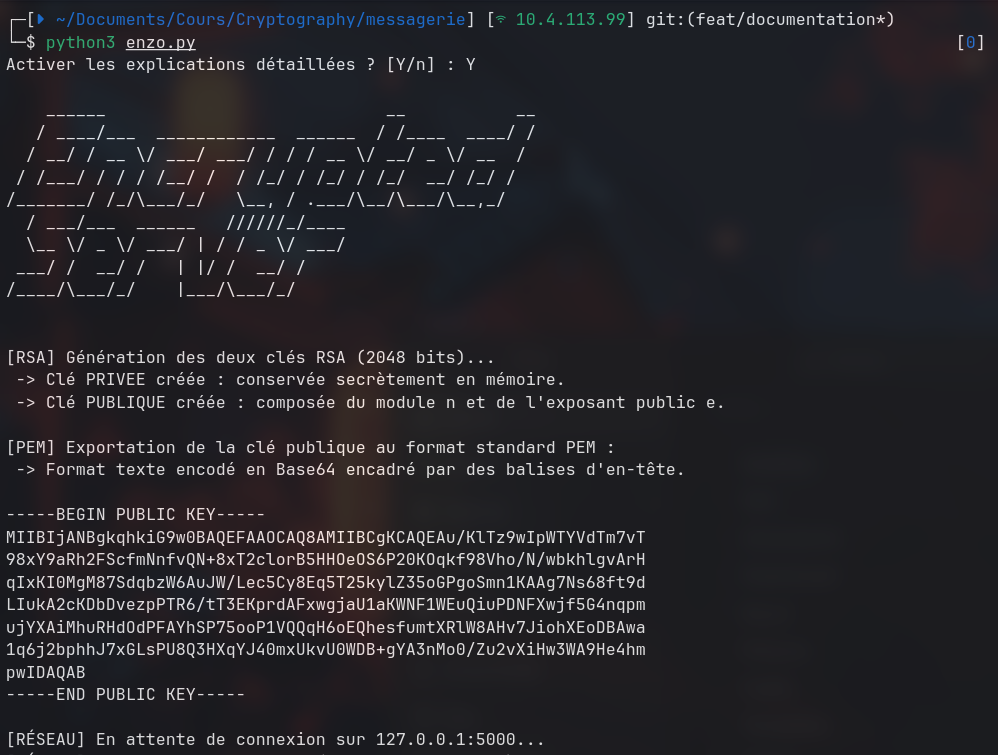
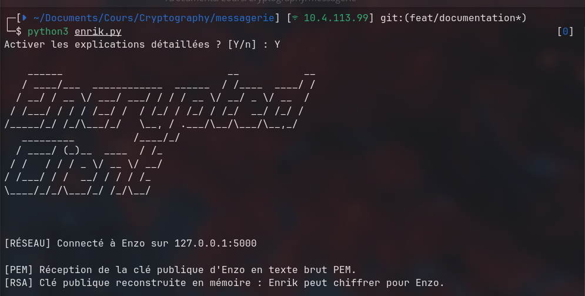
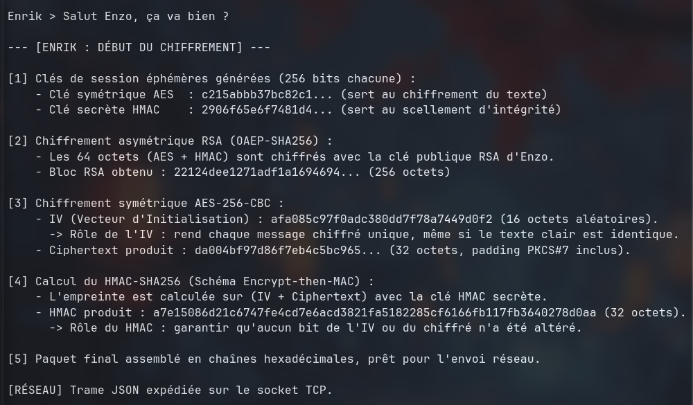
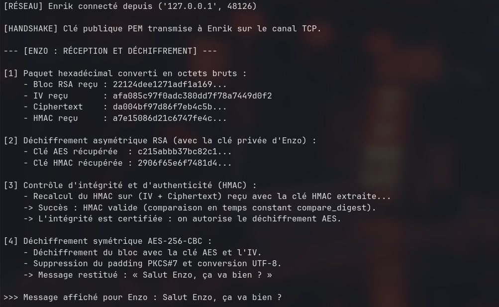
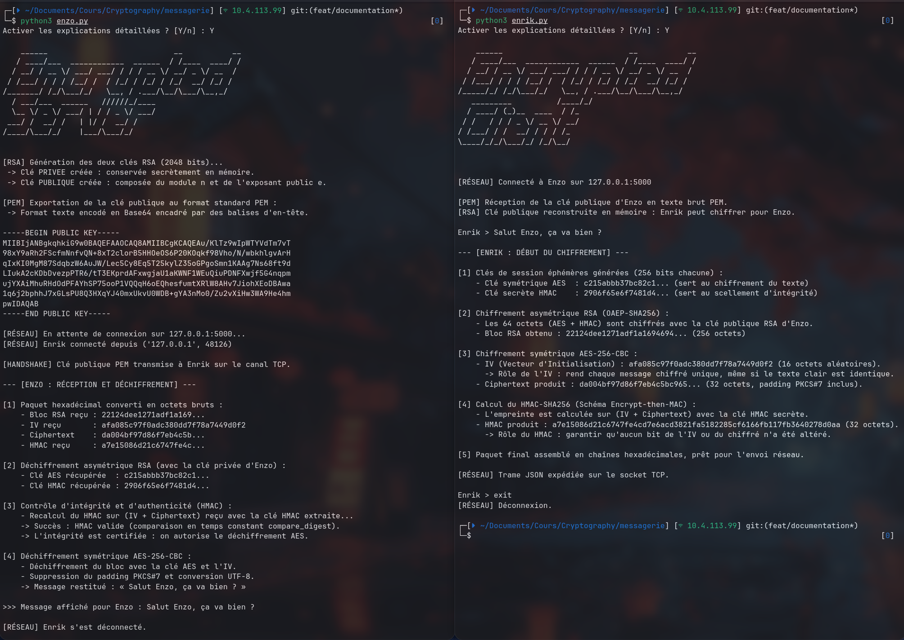

# Messagerie Hybride Sécurisée | Enrik & Enzo

* **Auteurs :** Enrik DOLLE & Enzo BOURGOIN
* **Cours :** Fondamentaux de la cryptographie — Master 1 (spé. Offensif/Défensif)

<p align="left">
  <p><a href="#contexte">1. Vue d'ensemble du projet</a></p>
  <p><a href="#architecture">2. Architecture du code</a></p>
  <p><a href="#installation">3. Installation & Démonstration</a></p>
  <p><a href="#flux">4. Spécification des flux</a></p>
  <p><a href="#details">5. Projet en images</a>
  <p><a href="#security">6. Analyse de sécurité</a></p>
</p>

</br>

## <span id="contexte"></span>1. Vue d'ensemble du projet

Cette application implémente un système de messagerie sécurisé de bout en bout en console entre deux terminaux indépendants (local) :
* **Enzo (Serveur TCP) :** détient une paire de clés asymétriques RSA et reçoit les messages.
* **Enrik (Client TCP) :** récupère l'identité publique d'Enzo et chiffre les messages via un schéma hybride.

### Choix retenues dans le cadre du projet

| Rôle | Algorithme | Justification technique |
| :--- | :--- | :--- |
| **Chiffrement des données** | **AES-256-CBC** | Standard symétrique robuste. Padding PKCS#7. |
| **Unicité des messages** | **IV aléatoire (16 octets)** | Tirage d'une suite aléatoire (`os.urandom`) pour éviter qu'un même texte produise un même chiffré. |
| **Échange de clés** | **RSA-OAEP-SHA256 (2048 bits)** | Chiffre la combinaison des clés de session (`AES` + `HMAC`). |
| **Intégrité et authenticité** | **HMAC-SHA256** | Schéma *Encrypt-then-MAC* appliqué sur `IV + ciphertext`. |
| **Format des clés** | **PEM / PKCS#8** | Standard ouvert garantissant l'interopérabilité (encodage Base64 structuré, type clé SSH). |

</br>

## <span id="architecture"></span> 2. Architecture du code

```text
├── crypto_utils.py     # Logique chiffrement symétriques (AES-CBC, padding, HMAC)
├── rsa_utils.py        # Logique chiffrement asymétriques (génération RSA, OAEP, clés PEM)
├── messenger.py        # Logique de l'application de messagerie (send_message, receive_message)
├── network_utils.py    # Encapsulation réseau (en trames JSON, délimitées par \n)
├── enzo.py             # Point d'entrée serveur (destinataire)
├── enrik.py            # Point d'entrée client (expéditeur)
└── requirements.txt    # Dépendances (cryptography)
``` 

</br>

## 3. <span id="installation"></span> Installation & Démonstration

### Prérequis :
- Python 3.10+
- Librairie `cryptographie`

</br>

```
pip install -r requirements.txt
```

### Exécution :

**Ouvrir 2 terminaux distincts**

1. **TERMINAL N°1 | Enzo (Serveur)**

```
python3 enzo.py
```

2. **TERMINAL N°2 | Enrik (Client)**

```
python3 enrik.py
```

> [!IMPORTANT]
> Au lancement de chaque script (Serveur ou Client), un input permet de sélectionner le mode **PEDAGOGIQUE** en répondant `Y`, ou refuser avec `n` .

### Démonstration :



Toutes les étapes de chiffrement, l'envoi via TCP socket en local ainsi que le déchiffrement sont annotées lors du mode `pédagogique|verbose`. Cette option permet de mieux comprendre comment chaque étapes et composants s'imbriquent dans un **échange chiffré**.

</br>

## <span id="flux"></span> 4. Spécification des flux

### Structure du paquet JSON
Chaque message expédié par Enrik (Client) est encapsulé dans une trame JSON sérialisée sur **UNE** ligne unique terminée par `\n` pour prévenir la fragmentation et la concaténation de flux TCP :

```json
{
  "cles_chiffrees": "3a8f... (512 hex chars = 256 octets chiffrés RSA-OAEP)",
  "iv":             "e1c4... (32 hex chars = 16 octets CSPRNG)",
  "ciphertext":     "9b02... (variable, multiple de 16 octets post-padding PKCS#7)",
  "hmac":           "a4f8... (64 hex chars = 32 octets HMAC-SHA256)"
}
```

### Diagramme de flux

```text
[ENRIK] (Client)                                    [ENZO] (Serveur)
     │                                                    │
     │ ──────── 1. Connexion TCP (Port 5000) ───────────> │
     │ <─────── 2. Handshake : Clé Publique PEM ───────── │
     │                                                    │
 [Génération]                                             │
 • Clé AES-256 éphémère                                   │
 • Clé HMAC-256 éphémère                                  │
 • IV aléatoire                                           │
                                                          │
 [Chiffrement]                                            │
 • Clés via RSA-OAEP(avec enzo_pub)                       │
 • Message chiffré via AES-CBC(aes_key, iv)               │
 • Sceau via HMAC(hmac_key, iv + ciphertext)              │
     │                                                    │
     │ ──────── 3. Trame JSON (Hexadécimal + \n) ───────> │
     │                                                    │
     │                                            [Déchiffrement]
     │                                            • Récup.clés via RSA-OAEP (enzo_priv)
     │                                            • VERIFICATION HMAC : iv + ciphertext
     │                                              └── Valide   ➔ Déchiffrement AES-CBC
```

</br>

## <span id="details"></span> 5. Le projet en images

Cette section illustre pas à pas le déroulement d'une session complète en mode pédagogique (verbose) entre les deux terminaux.

### A. Initialisation du serveur (Serveur:Enzo)
Enzo démarre son service, génère sa paire de clés RSA-2048, exporte sa clé publique au format standard PEM et se place en écoute sur `127.0.0.1:5000`.



---

### B. Connexion du client et Handshake (Client:Enrik)
Enrik établit une liaison TCP vers Enzo en local, réceptionne le bloc PEM contenant la clé publique et reconstruit l'objet RSA en mémoire vive.



---

### C. Chiffrement hybride et expédition (Client:Enrik)
Détail des opérations cryptographiques lors de la saisie d'un message : génération des clés éphémères de 256 bits, chiffrement asymétrique RSA-OAEP des secrets, chiffrement symétrique AES-256-CBC avec son IV aléatoire et calcul du HMAC-SHA256 (*Encrypt-then-MAC*).



---

### D. Contrôle d'intégrité et déchiffrement (Serveur:Enzo)
Enzo extrait la trame JSON, récupère les clés via sa clé privée RSA, contrôle la validité du HMAC en temps constant (`compare_digest`) et autorise enfin le déchiffrement AES-CBC pour restituer le texte clair : « Salut Enzo, ça va bien ? ».



---

### E. Vue d'ensemble de la session en direct
Supervision simultanée des deux terminaux démontrant l'échange réseau de bout en bout et la fermeture propre de session.



</br>

## <span id="security"></span> 6. Analyse de sécurité

### A. Protection contre les padding (Schéma Encrypt-then-MAC)
- **Vecteur d'attaque :** dans un schéma vulnérable, un attaquant injecte des blocs modifiés pour observer si le serveur renvoie une erreur de padding ou d'intégrité, permettant de déchiffrer le message octet par octet.
- **Parade implémentée :** l'approche **Encrypt-then-MAC** calcule le HMAC sur `IV + ciphertext`. Enzo vérifie l'intégrité **avant** d'appeler le déchiffrement AES. Si un seul bit est altéré par un attaquant en transit, le paquet est immédiatement rejeté sans qu'aucune opération de dépouillement du padding ne soit exécutée.

### B. Résistance aux attaques par canal auxiliaire (*Timing Attacks*)
- **Vecteur d'attaque :** comparer deux chaînes d'octets avec l'opérateur standard `==` s'interrompt dès le premier octet différent. En mesurant la latence réseau, un attaquant peut deviner le HMAC octet par octet.
- **Parade implémentée :** utilisation systématique de `hmac.compare_digest()` qui effectue une comparaison en temps constant, indépendamment du point de divergence.

### C. Sécurisation du transport RSA (OAEP)
- **Vecteur d'attaque :** le chiffrement RSA standard sans masquage est vulnérable à l'attaque à texte chiffré choisi de Bleichenbacher (attaque du million de requêtes).
- **Parade implémentée :** emploi d'**OAEP** avec une fonction de hachage SHA-256 et un masque MGF1, éliminant tout déterminisme dans le bloc chiffré.

### D. Rôle de l'IV
- L'IV n'est pas un secret, mais il **doit être imprévisible**. L'utilisation de `os.urandom(16)` (interfacé avec `/dev/urandom` sur Linux) garantit que l'émission répétée d'un même message clair produit deux `ciphertext` strictement différents, neutralisant toute analyse statistique ou dictionnaire de fréquences.